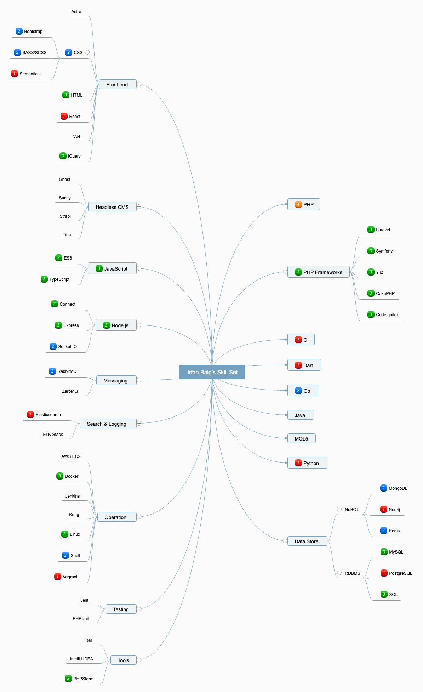

# SkillSet
A simple JSON format for skill sets and a mind map generator

[Live demo](https://irfanbaigse.github.io/SkillSet/) · Forked from [NexZhu/SkillSet](https://github.com/NexZhu/SkillSet)

## Background

Initially created to help me choose technology stacks for 2015 Eleme Hackathon according to the skill sets of my teammates and me.

SkillSet can also be used to communicate skill sets and skill requirements between employers and job seekers, or to help leaders optimize assignment of tasks to teams.

SkillSet uses [Baidu FEX team](http://fex.baidu.com/)'s [Kity](https://github.com/fex-team/kity) and [KityMinder Core](https://github.com/fex-team/kityminder-core) to generate mind maps.

## Skill Levels

    0: Not rated yet (shown without a level badge)
    1: Novice
    2: Intermediate
    3: Advanced
    4: Expert
    5: Master

## My Skill Set

### JSON

[`docs/skill-set.json`](docs/skill-set.json). Nested objects are categories, numbers are levels, and `.level` sets a category's own level:

    {
      "name": "Irfan Baig",
      "skillset": {
        "PHP": 4,
        "PHP Frameworks": {
          ".level": 3,
          "Laravel": 3
        }
      }
    }

### Generated Mind Map

## Run locally

    npm ci
    npm start

`npm run build` bundles `src/` into `public/bundle.js` and copies `docs/skill-set.json` next to it; `npm start` also serves `public/`. Use **Save as PNG** in the demo to regenerate `docs/skill-set.png`.

Pushing to `master` deploys `public/` to GitHub Pages.
